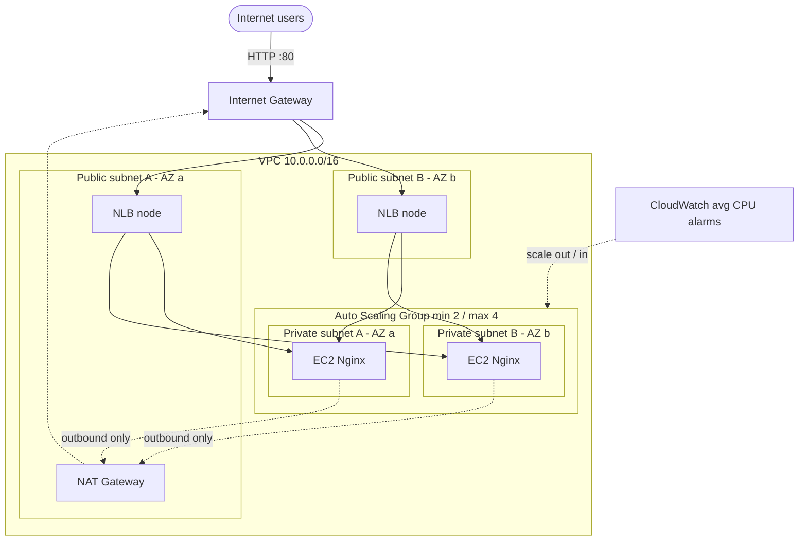

# AWS Network Load Balancer + EC2 Auto Scaling Group with Terraform

An internet-facing **Network Load Balancer (NLB)** distributes TCP traffic across **Nginx web servers** running in an **Auto Scaling Group (ASG)** in private subnets. Capacity scales automatically between 2 and 4 instances based on average CPU (target tracking at 60%). Everything is created with Terraform, with remote state in S3.

**Highlights**

- Custom VPC (`10.0.0.0/16`), 2 public + 2 private subnets across 2 AZs, IGW, NAT Gateway, route tables
- Ubuntu 24.04 LTS `t3.micro` instances, no public IPs, IMDSv2 enforced, encrypted EBS, SSM Session Manager access
- NLB: TCP :80 listener, instance target group, **HTTP health checks**, cross-zone load balancing
- ASG: min 2 / desired 2 / max 4, **ELB health checks**, automatic replacement of unhealthy instances, rolling instance refresh
- Two separate security groups: the web servers accept port 80 **only from the NLB security group**
- S3 backend with native state locking (`use_lockfile`), no secrets in Git

## Architecture


```text
                          Internet users
                                |
                       [ Internet Gateway ]
                                |
  +------------------------ VPC 10.0.0.0/16 ------------------------------+
  |                                                                        |
  |  Public subnet A (AZ a)  10.0.1.0/24    Public subnet B (AZ b) 10.0.2.0/24
  |   +-- NLB node  <== Network Load Balancer (TCP :80, cross-zone) ==> NLB node
  |   +-- NAT Gateway                                                       |
  |            |  (outbound only)                                           |
  |  - - - - - | - - - - - - - Auto Scaling Group (min 2 / max 4) - - - - - |
  |  Private subnet A (AZ a) 10.0.11.0/24   Private subnet B (AZ b) 10.0.12.0/24
  |   +-- EC2 Ubuntu + Nginx                 +-- EC2 Ubuntu + Nginx         |
  |  - - - - - - - - - - - - - - - - - - - - - - - - - - - - - - - - - - - |
  +------------------------------------------------------------------------+
        CloudWatch (avg CPU, target 60%)  -->  scales the ASG out / in
```



## Project structure

```text
aws-nlb-autoscaling/
├── provider.tf            # Terraform + AWS provider settings, S3 backend (lockfile)
├── variables.tf           # Input variables with validation
├── terraform.tfvars       # Variable values (no secrets)
├── main.tf                # Data sources, locals, IAM role/profile, SSH key pair
├── vpc.tf                 # VPC, subnets, IGW, NAT, route tables
├── security_groups.tf     # NLB and EC2 security groups and rules
├── launch_template.tf     # EC2 Launch Template
├── autoscaling.tf         # Auto Scaling Group + target tracking policy
├── nlb.tf                 # NLB, target group, listener
├── outputs.tf             # Output values
├── userdata.sh            # First-boot script: install and configure Nginx
├── scripts/
│   └── bootstrap-state.sh # Creates the S3 state bucket and backend.hcl
├── docs/
│   ├── architecture.svg
│   ├── RESOURCES.md       # What every resource does and why
│   ├── CONCEPTS.md        # NLB vs ALB, health checks, scaling, HA ...
│   ├── TESTING.md         # Validation tests with commands
│   ├── TROUBLESHOOTING.md # 10 failure scenarios and how to debug them
│   ├── SECURITY.md        # Security practices used and next steps
│   └── INTERVIEW_QUESTIONS.md
└── README.md
```

## Prerequisites

- Terraform **1.10+** (needed for S3 native locking) and AWS CLI v2
- An AWS account and credentials (`aws configure`) allowed to create VPC, EC2, ELB, IAM, S3
- An SSH key pair on your machine (only the public key is uploaded):

```bash
ssh-keygen -t ed25519 -f ~/.ssh/aws-nlb-demo -N ""
```

## Quick start

```bash
# 1. One-time: create the S3 bucket for remote state (writes backend.hcl)
./scripts/bootstrap-state.sh ap-south-1

# 2. Deploy
terraform init -backend-config=backend.hcl
terraform fmt
terraform validate
terraform plan -out=tfplan
terraform apply tfplan

# 3. Test
terraform output nlb_url
curl "$(terraform output -raw nlb_url)"

# 4. Clean up (NAT Gateway and NLB bill hourly!)
terraform destroy
```

> No S3 bucket yet and just want to try it? Comment out the `backend "s3"` block in `provider.tf` and run a plain `terraform init` (state stays local).

## Deployment workflow explained

| # | Command | What it does |
|---|---------|--------------|
| 1 | `terraform init -backend-config=backend.hcl` | Downloads the AWS provider, connects to the S3 backend (bucket and region come from `backend.hcl`) and creates `.terraform.lock.hcl`. Run it again whenever providers or the backend change. |
| 2 | `terraform fmt` | Rewrites `.tf` files into canonical style. Use `terraform fmt -check` in CI. |
| 3 | `terraform validate` | Checks syntax, types and references offline (no AWS calls). |
| 4 | `terraform plan -out=tfplan` | Compares code, state and real AWS, prints what will be created/changed/destroyed. Saving the plan guarantees `apply` does exactly what you reviewed. |
| 5 | `terraform apply tfplan` | Creates the resources in dependency order and waits until the ASG has 2 instances healthy in the NLB (`min_elb_capacity`), typically 4-6 minutes. |
| 6 | `terraform output` | Prints NLB URL, IDs and ready-to-run AWS CLI commands. |
| 7 | `terraform destroy` | Deletes everything in reverse order. The state bucket is not managed by this project and stays. |

### How Terraform builds the infrastructure

Terraform builds a dependency graph from resource references and creates independent resources in parallel:

1. **VPC** → **Internet Gateway**, subnets
2. **Elastic IP(s)** → **NAT Gateway(s)** (needs the IGW and a public subnet)
3. **Route tables**, default routes (public → IGW, private → NAT) and subnet associations
4. **IAM role/instance profile**, **key pair**, **security groups**
5. **Launch Template** (AMI, instance type, user data, SG, profile)
6. **NLB**, **target group**, **listener**
7. **Auto Scaling Group** (after the listener and private routes, via `depends_on`), which launches instances in the private subnets and registers them in the target group
8. **Scaling policy**, which makes the ASG create the CloudWatch alarms

Only three explicit `depends_on` exist, each with a comment explaining why (EIP/NLB need the IGW; the ASG needs the listener and private routes).

### How CloudWatch and the ASG react to demand

Each instance publishes `CPUUtilization` to CloudWatch (every 1 minute with detailed monitoring). The ASG aggregates these into `ASGAverageCPUUtilization`. The target tracking policy creates and manages two alarms for you:

- **AlarmHigh**: average CPU above 60% for 3 consecutive 1-minute datapoints → the ASG adds instances in proportion to the overshoot (scale out), up to `max_size = 4`.
- **AlarmLow**: CPU well below the target for 15 consecutive 1-minute datapoints → the ASG removes instances one by one (scale in), never below `min_size = 2`.

Scaling out is fast and scaling in is deliberately slow, so brief dips never remove capacity you still need. New instances join the NLB target group automatically and receive traffic once they pass the health checks.

## Testing

Quick check once `terraform apply` finishes:

```bash
NLB=$(terraform output -raw nlb_dns_name)
for i in $(seq 1 10); do curl -s "http://$NLB" | grep -o 'Welcome from [^<]*'; done
```

You should see responses from at least two different hostnames. The full 10-step test plan (CPU load, scale-out, new targets registering, instance termination, availability during scaling) is in [docs/TESTING.md](docs/TESTING.md).

## More documentation

| Document | Contents |
|----------|----------|
| [docs/RESOURCES.md](docs/RESOURCES.md) | Explanation of every AWS resource created |
| [docs/CONCEPTS.md](docs/CONCEPTS.md) | NLB vs ALB, ASG vs Launch Template, health checks, capacity, target tracking, cross-zone, HA, scaling types |
| [docs/TESTING.md](docs/TESTING.md) | Validation tests with Linux and AWS CLI commands |
| [docs/TROUBLESHOOTING.md](docs/TROUBLESHOOTING.md) | Ten common failures and how to diagnose them |
| [docs/SECURITY.md](docs/SECURITY.md) | Security practices implemented and recommended hardening |
| [docs/INTERVIEW_QUESTIONS.md](docs/INTERVIEW_QUESTIONS.md) | Five DevOps interview questions with answers |

## Cost notes

Resources that bill while they exist: **NAT Gateway** (hourly + data), **NLB** (hourly + LCU), **EC2 instances**, and a small amount for EBS and detailed monitoring. `single_nat_gateway = true` keeps costs down at the price of an AZ-level single point of failure; set it to `false` for one NAT Gateway per AZ. Always run `terraform destroy` after experimenting.

## Design decisions worth knowing

- **Client IP preservation is off** on the target group so the instance security group can allow traffic from the NLB security group instead of from `0.0.0.0/0`. Nginx therefore sees the NLB's IP, not the visitor's. If you need real client IPs, enable it and allow the client CIDRs on the instance security group (or enable Proxy Protocol v2).
- **`ignore_changes = [desired_capacity]`** on the ASG so `terraform apply` does not undo scaling decisions made by the policy.
- **Instances live in private subnets** and are reachable only through the NLB; shell access is via SSM Session Manager (SSH is allowed only from inside the VPC by default).
- **Provider version** is constrained to `>= 5.90, < 7.0` so the `availability_zone_distribution` block (added in the 5.x series) is available.

## Possible next steps

- Split `vpc.tf` and the ASG/NLB pair into reusable Terraform modules
- Add TLS with a TLS listener and an ACM certificate (port 443)
- Use Application Load Balancer + WAF if you need HTTP routing or L7 protection
- CI pipeline with `fmt -check`, `validate`, `tflint` and `checkov`
- VPC Flow Logs and CloudWatch Agent for memory and disk metrics

## License

MIT
