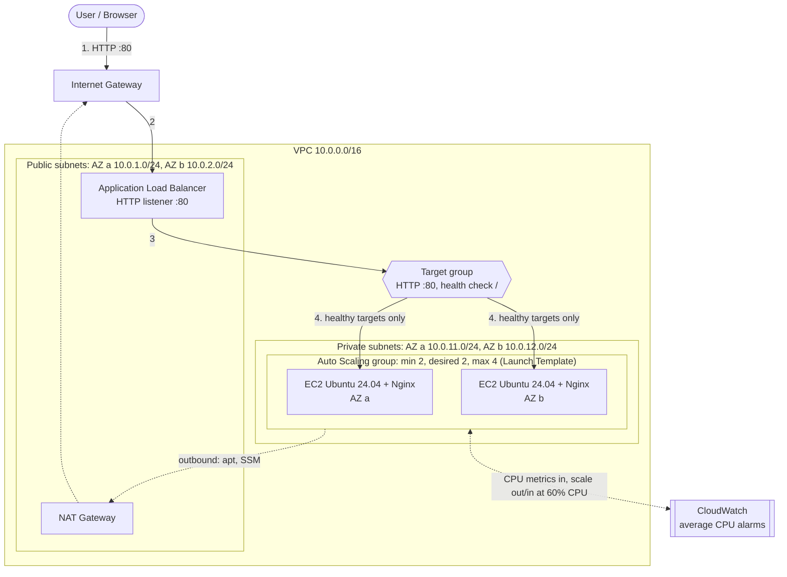

# AWS EC2 Auto Scaling Group with Terraform

A scalable, highly available web tier on AWS built entirely with Terraform: Ubuntu 24.04 instances running Nginx, launched from a Launch Template into an Auto Scaling Group (ASG) across two Availability Zones, fronted by an Application Load Balancer (ALB), and scaled automatically on CPU with a target tracking policy.

## Architecture




**Request flow:** browser -> Internet Gateway -> ALB (public subnets) -> target group -> a healthy instance in a private subnet. Instances reach the internet outbound only, through the NAT gateway.

**Scaling flow:** instances publish CPU metrics to CloudWatch -> the target tracking policy keeps the group average near 60% -> ASG launches or terminates instances between 2 and 4 -> new instances register with the target group automatically.

## Folder structure

```
asg-terraform/
├── provider.tf          # Terraform + provider versions, S3 backend with lockfile, default tags
├── variables.tf         # All input variables with descriptions and validation
├── terraform.tfvars     # Values for this deployment (no secrets)
├── main.tf              # Shared data (AZs, Ubuntu AMI), locals, input checks
├── vpc.tf               # VPC, subnets, IGW, NAT gateway, route tables
├── security_groups.tf   # ALB security group and instance security group
├── launch_template.tf   # Key pair, SSM IAM role, Launch Template
├── autoscaling.tf       # Auto Scaling group + target tracking policy
├── alb.tf               # ALB, target group, HTTP listener
├── outputs.tf           # DNS name, IDs, ready-made check commands
├── userdata.sh          # Instance init script: installs Nginx, writes the hostname page
├── docs/                # Architecture diagram (PNG + Mermaid source)
└── README.md
```

## What each resource does

| Resource | File | Purpose |
|---|---|---|
| `aws_vpc.main` | vpc.tf | Isolated network, CIDR `10.0.0.0/16` |
| `aws_subnet.public` (x2) | vpc.tf | One per AZ; hold the ALB and NAT gateway |
| `aws_subnet.private` (x2) | vpc.tf | One per AZ; hold the ASG instances (no public IPs) |
| `aws_internet_gateway.main` | vpc.tf | Internet access for the public subnets |
| `aws_nat_gateway.main` + `aws_eip.nat` | vpc.tf | Outbound-only internet for private instances (apt, SSM). One shared NAT by default; one per AZ with `single_nat_gateway = false` |
| `aws_route_table.public/private` + routes + associations | vpc.tf | Public: `0.0.0.0/0` to IGW. Private: `0.0.0.0/0` to NAT |
| `aws_security_group.alb` | security_groups.tf | Only port 80 from allowed CIDRs; may only send to the instances |
| `aws_security_group.instances` | security_groups.tf | Port 80 only from the ALB security group; SSH only if you list CIDRs |
| `aws_key_pair.this` | launch_template.tf | Uploads your SSH **public** key |
| `aws_iam_role` + instance profile | launch_template.tf | SSM Session Manager access (shell without opening port 22) |
| `aws_launch_template.web` | launch_template.tf | The blueprint: Ubuntu 24.04 AMI, t3.micro, key pair, security group, user data, detailed monitoring, IMDSv2, encrypted disk, tags |
| `aws_autoscaling_group.web` | autoscaling.tf | Keeps 2 to 4 instances running across two AZs, replaces failed ones, attaches them to the target group |
| `aws_autoscaling_policy.cpu_target_tracking` | autoscaling.tf | Keeps average CPU near 60% by adding or removing instances |
| `aws_lb.web` | alb.tf | Internet-facing ALB across both public subnets |
| `aws_lb_target_group.web` | alb.tf | HTTP :80 targets with a `/` health check |
| `aws_lb_listener.http` | alb.tf | Port 80 listener forwarding to the target group |

## Prerequisites

- Terraform 1.10 or newer (S3 native state locking)
- AWS CLI configured (`aws configure`) with permissions for VPC, EC2, ELB, Auto Scaling, IAM, CloudWatch and S3
- An SSH key pair on your machine and an S3 bucket for state (below)

### 1. Create the SSH key (public half goes to AWS, private half stays on your machine)

```bash
ssh-keygen -t ed25519 -f ~/.ssh/asg-demo -C asg-demo
```

Terraform reads only `~/.ssh/asg-demo.pub` (`public_key_path`). Never commit the private key (`.gitignore` blocks `*.pem`, `*.key`, `id_*`).

### 2. Create the remote-state bucket

`use_lockfile = true` makes Terraform write a `.tflock` object next to the state, so two people cannot apply at once. No DynamoDB table is needed.

```bash
BUCKET=my-tfstate-$(aws sts get-caller-identity --query Account --output text)-ap-south-1

aws s3api create-bucket --bucket "$BUCKET" --region ap-south-1 \
  --create-bucket-configuration LocationConstraint=ap-south-1
aws s3api put-bucket-versioning --bucket "$BUCKET" --versioning-configuration Status=Enabled
aws s3api put-bucket-encryption --bucket "$BUCKET" \
  --server-side-encryption-configuration '{"Rules":[{"ApplyServerSideEncryptionByDefault":{"SSEAlgorithm":"AES256"}}]}'
aws s3api put-public-access-block --bucket "$BUCKET" \
  --public-access-block-configuration BlockPublicAcls=true,IgnorePublicAcls=true,BlockPublicPolicy=true,RestrictPublicBuckets=true
```

## Deployment workflow

```bash
terraform init -backend-config="bucket=$BUCKET"
terraform fmt -recursive
terraform validate
terraform plan -out=tfplan
terraform apply tfplan
terraform output
terraform destroy
```

| Command | What it does |
|---|---|
| `terraform init` | Downloads the AWS provider and connects the S3 backend. Run once per clone, and again after changing backend or provider settings (`-reconfigure`). |
| `terraform fmt` | Rewrites the files into the standard style. Use `-check` in CI. |
| `terraform validate` | Checks syntax, references and types without touching AWS. |
| `terraform plan` | Compares your code with the state and with AWS and shows exactly what will change. `-out=tfplan` saves it so apply runs precisely that plan. |
| `terraform apply` | Creates the resources (about 5 to 8 minutes; the NAT gateway and ALB are the slow parts). |
| `terraform output` | Prints the values from `outputs.tf`, such as the ALB URL and check commands. |
| `terraform destroy` | Deletes everything Terraform created. Run it when you finish, because the NAT gateway and ALB bill hourly. |

## Testing and validation

Set a few shell variables after apply:

```bash
URL=$(terraform output -raw alb_url)
ASG=$(terraform output -raw autoscaling_group_name)
REGION=ap-south-1
```

### Tests 1 and 2: open the ALB and see Nginx

Wait 3 to 5 minutes after apply (instances must boot, run apt and pass health checks), then open the URL in a browser. You should see "Hello from ip-10-0-..." with the instance ID and AZ.

```bash
for i in $(seq 1 10); do curl -s "$URL" | grep -o "Hello from [^<]*"; done
```

Both hostnames should appear, which shows the ALB spreading requests across instances.

### Tests 5 to 7 helpers: capacity and target health

```bash
# Min, desired, max and each instance's AZ, state and health
$(terraform output -raw describe_asg_command)

# What the ALB thinks of each target
$(terraform output -raw check_target_health_command)
```

### Test 3: generate CPU load

Target tracking watches the **group average**. One busy instance out of two only gives about 50%, which is below the 60% target, so load **both** instances.

```bash
# Find the instance IDs
aws autoscaling describe-auto-scaling-groups --auto-scaling-group-names "$ASG" --region $REGION \
  --query 'AutoScalingGroups[0].Instances[].InstanceId' --output text

# Open a shell on each instance (no SSH needed; repeat in a second terminal for the other one)
aws ssm start-session --target <instance-id> --region $REGION
```

Inside each instance:

```bash
sudo apt-get install -y stress-ng sysstat htop
stress-ng --cpu 0 --cpu-load 100 --timeout 900s     # 0 = use every vCPU, run for 15 minutes
# no-install alternative: start one busy loop per core
# for i in $(seq $(nproc)); do yes > /dev/null & done      (stop with: pkill yes)
```

Watch resources from a second session on the same instance:

```bash
top                  # live CPU and memory (press q to quit)
htop                 # friendlier view
uptime               # load averages
vmstat 5             # CPU, memory and I/O every 5 seconds
mpstat -P ALL 5      # CPU per core
free -h              # memory
df -h                # disk
```

Note: t3 instances are burstable (unlimited mode by default), so sustained 100% CPU works but can add a small surplus-credit charge.

### Test 4: monitor CPU in CloudWatch

Console: CloudWatch > Alarms (the two `TargetTracking-...` alarms) and CloudWatch > Metrics > EC2 > By Auto Scaling Group > `CPUUtilization`.

CLI:

```bash
aws cloudwatch get-metric-statistics --region $REGION \
  --namespace AWS/EC2 --metric-name CPUUtilization \
  --dimensions Name=AutoScalingGroupName,Value=$ASG \
  --start-time $(date -u -d '-30 minutes' +%FT%TZ) --end-time $(date -u +%FT%TZ) \
  --period 60 --statistics Average --query 'sort_by(Datapoints,&Timestamp)[].[Timestamp,Average]' --output table

aws cloudwatch describe-alarms --region $REGION --alarm-name-prefix "TargetTracking-$ASG" \
  --query 'MetricAlarms[].[AlarmName,StateValue]' --output table
```

### Tests 5 to 7: scale-out, capacity and registration

Within about 3 to 5 minutes of sustained high CPU the high alarm goes to `ALARM` and the group grows (toward 4).

```bash
aws autoscaling describe-scaling-activities --auto-scaling-group-name "$ASG" --region $REGION --max-items 5 \
  --query 'Activities[].[StartTime,StatusCode,Description]' --output table

$(terraform output -raw describe_asg_command)          # desired should rise above 2, never above 4
$(terraform output -raw check_target_health_command)   # new instances appear as initial, then healthy
```

### Test 8: terminate an instance and watch replacement

```bash
aws ec2 terminate-instances --instance-ids <instance-id> --region $REGION
watch -n 10 "$(terraform output -raw describe_asg_command)"
```

The ASG notices the instance is gone, launches a replacement in the same or the other AZ, and the target group registers it once it passes health checks. The same happens if you stop the instance, because its EC2 status check fails.

Important: with `health_check_type = "EC2"`, an instance whose Nginx has crashed but whose VM is fine is **not** replaced. The ALB stops sending it traffic, but the ASG keeps it. Set `health_check_type = "ELB"` in `terraform.tfvars` to let the ASG also replace instances the ALB reports unhealthy.

### Test 9: the app stays up during scaling

Run this in a separate terminal before you start the load and keep it running through scale-out and the termination test:

```bash
while true; do curl -s -o /dev/null -w "%{http_code} " "$URL"; sleep 1; done
```

You should see only `200`. An occasional `502` or `503` during a termination means a request hit an instance in its final moments; the 30 second `deregistration_delay` and ALB health checks keep this rare.

### Scale-in

After you stop the load, average CPU drops. Target tracking waits roughly 15 minutes of low data before removing instances (it scales in slowly on purpose), then reduces the group one step at a time and **never below the minimum of 2**.

## How CloudWatch and Auto Scaling work together

1. Each instance publishes `CPUUtilization` to CloudWatch (every 1 minute with detailed monitoring, every 5 minutes without).
2. The ASG aggregates them into the group average (`ASGAverageCPUUtilization`).
3. When you create a target tracking policy, AWS creates and manages two CloudWatch alarms for you: a high alarm (roughly 3 consecutive 1-minute datapoints above the target) and a low alarm (about 15 datapoints well below the target).
4. High alarm -> the policy calculates how many instances are needed to bring the average back to 60% and raises desired capacity (up to max 4).
5. Low alarm -> it lowers desired capacity gradually (down to min 2).
6. New instances get a warmup period (`instance_warmup_seconds`) so their still-booting CPU does not distort the average.

That is why detailed monitoring is on by default: with 5-minute metrics the same three datapoints take about 15 minutes.

## Concepts explained

| Topic | Explanation |
|---|---|
| **ASG vs Launch Template** | The Launch Template says **what** to launch (AMI, instance type, key, security group, user data, tags). The ASG says **how many and where** (min/desired/max, subnets, health checks, scaling policies). The ASG uses the template. |
| **Min, desired, max** | Min is the floor (the ASG never goes below it, even when idle). Max is the ceiling (cost cap). Desired is the number it is trying to run right now; scaling policies move it between min and max. |
| **Horizontal vs vertical scaling** | Horizontal adds or removes instances (what an ASG does): no downtime, scales far, needs a stateless app. Vertical makes one instance bigger (a larger instance type): simple but needs a restart and has a hard ceiling. |
| **Dynamic vs scheduled scaling** | Dynamic reacts to live metrics such as CPU. Scheduled changes capacity at set times (for example, scale up at 9 AM on weekdays) for predictable patterns. They can be combined. |
| **Target tracking vs step scaling** | Target tracking: you pick a metric target ("keep CPU at 60%") and AWS manages the alarms and calculates the size of each change. Step scaling: you define alarms and exact steps ("above 70% add 1, above 85% add 3"). Target tracking is simpler and AWS's recommendation; step scaling gives finer manual control. |
| **EC2 vs ELB health checks** | EC2 checks only whether the VM is running and passes AWS status checks (hardware, network, OS). ELB checks whether the application answers the health check path. ELB catches app crashes that EC2 cannot see. This project uses EC2 as specified; switch to ELB for production. |
| **ALB vs NLB** | ALB is Layer 7: understands HTTP, routes by path, host or header, supports redirects and WAF. NLB is Layer 4: forwards TCP/UDP/TLS connections with very low latency and static IPs per AZ. Use ALB for web apps and APIs, NLB for raw TCP, extreme throughput or fixed IPs. |

## Troubleshooting

| Problem | What to check and how to fix |
|---|---|
| **EC2 instances fail to launch** | `aws autoscaling describe-scaling-activities` shows the failure reason. Common: `InsufficientInstanceCapacity` (try another instance type or AZ), `InvalidKeyPair` (key pair deleted), `VcpuLimitExceeded` (quota), invalid AMI or security group, or the service-linked role missing permissions on a KMS key. |
| **ASG not scaling out** | Is desired already at max? Are the alarms in `ALARM` (CloudWatch > Alarms)? Is the metric the group average (load **every** instance)? Is the instance still in warmup? Is a scaling activity in cooldown? Check `describe-scaling-activities` and the policy with `aws autoscaling describe-policies`. |
| **CloudWatch alarms not triggering** | State `INSUFFICIENT_DATA` means no metrics: detailed monitoring off (5-minute data is slow), instances not yet running, or wrong dimension. High alarm needs about 3 minutes of sustained load, the low alarm about 15 minutes. Check the metric graph in the alarm. |
| **Instances show unhealthy** | ASG-side: `aws autoscaling describe-auto-scaling-groups` health status. Target-side: `describe-target-health` reason code. `Target.Timeout` means security group blocks the ALB; `Target.ResponseCodeMismatch` means the path does not return 200; `Target.FailedHealthChecks` means Nginx is down. SSM in and run `systemctl status nginx` and `curl -i localhost/`. |
| **ALB returns HTTP 503** | No healthy targets. Check that the target group has registered, healthy targets, the instances are still booting (grace period), the health check path returns 200, and the instance security group allows port 80 from the ALB security group. |
| **Launch Template configuration errors** | `terraform plan` / the ASG activity message quote the problem. Check AMI ID exists in the region, instance type is available in both AZs, key pair name exists, `user_data` is valid base64, and the instance profile exists. Validate with `aws ec2 describe-launch-template-versions`. |
| **Wrong subnet or security group** | ASG `vpc_zone_identifier` must be the **private** subnets in different AZs. Instances must be in the same VPC as the target group. Check the private route table has `0.0.0.0/0 -> NAT` and the NAT sits in a public subnet whose route table points to the IGW. The ALB must be in public subnets. |
| **User data script failures** | SSM into the instance: `sudo cat /var/log/cloud-init-output.log`, `cloud-init status --long`, `systemctl status nginx`. Usual causes: no NAT route (apt cannot download), a typo in the script, Windows line endings in `userdata.sh`. The script runs only on first boot; to retest, replace the instance. |
| **Instances not registering with the target group** | Confirm `target_group_arns` is set on the ASG and the instance is `InService`. A target stuck in `initial` is still waiting for health checks. Check the target group is in the same VPC and the port matches `app_port`. |

## Security best practices applied

- Instances are in **private subnets** with no public IPs; only the ALB is exposed
- **Separate security groups** for ALB and instances; instances accept port 80 only from the ALB security group; the ALB may only reach instances on the app port
- SSH is **closed by default** (`ssh_allowed_cidrs = []`) and cannot be opened to `0.0.0.0/0` (validation); shell access uses **SSM Session Manager**
- Only the SSH **public** key is in Terraform; the private key and any `*.pem` are git-ignored
- **IMDSv2 required**, encrypted EBS volumes, default security group has no rules
- Remote state in an encrypted, versioned, private S3 bucket with **lockfile locking**
- Consistent tags on everything (provider `default_tags`, launch template, ASG), consistent `<project>-<env>-<name>` naming
- Input validation and `check` blocks catch bad capacity values or mismatched subnet counts
- Least-privilege IAM: only `AmazonSSMManagedInstanceCore`

Production hardening ideas: HTTPS with an ACM certificate on the ALB, WAF, ALB access logs, `health_check_type = "ELB"`, `single_nat_gateway = false`, `enable_deletion_protection = true`, a scheduled-scaling action for known peaks, an SNS notification on scaling events, and a CI pipeline running `terraform fmt -check`, `validate`, `tflint` and `checkov`.

## Cost note

Billed while running: NAT gateway (hourly plus data), ALB (hourly plus LCUs), two or more t3.micro instances, detailed monitoring metrics. Run `terraform destroy` when you finish practicing.

## Interview questions and answers

**1. How does your Auto Scaling group decide when to add or remove instances?**
I used a target tracking policy on `ASGAverageCPUUtilization` with a 60% target. AWS creates two CloudWatch alarms. When the group average stays above the target, the policy calculates the capacity needed to bring it back to 60% and raises desired capacity, up to the max of 4. When CPU stays low for a longer period it scales in gradually, never below the minimum of 2. Instances get a warmup period so their boot-time CPU does not skew the metric.

**2. What is the difference between a Launch Template and an Auto Scaling group?**
The Launch Template is the instance blueprint: AMI, type, key pair, security groups, user data, IAM profile, tags. The ASG is the controller that decides how many instances to run, in which subnets and AZs, how to check their health and when to scale. Changing the template creates a new version; the ASG picks it up and an instance refresh rolls the instances gradually.

**3. Explain EC2 versus ELB health checks. Which would you use in production?**
EC2 health checks only detect that the VM or its status checks failed. ELB health checks request the application path through the load balancer and detect a crashed or hung Nginx. In this project the brief asks for EC2, so a crashed app is removed from the load balancer but not replaced. In production I would use ELB so the ASG also replaces instances the ALB marks unhealthy, with a grace period long enough for user data to finish.

**4. Users get HTTP 503 from the ALB. How do you troubleshoot it?**
A 503 means the ALB has no healthy targets. I check target health and its reason code, confirm the ASG instances are `InService` and registered, test `curl localhost/` on an instance through SSM, check `systemctl status nginx` and `/var/log/cloud-init-output.log`, verify the health check path returns 200, and confirm the instance security group allows the app port from the ALB security group. Then I check that scaling activity is not mid-replacement.

**5. Why are the instances in private subnets, and what does the NAT gateway do?**
Private instances have no public IPs and no inbound path from the internet, so only the ALB is exposed, which reduces the attack surface. They still need outbound access to install packages and talk to SSM, so a NAT gateway in a public subnet translates their traffic to its Elastic IP. The trade-off is cost and a single point of failure: one shared NAT is cheaper for dev, while production uses one NAT per AZ (`single_nat_gateway = false`).
